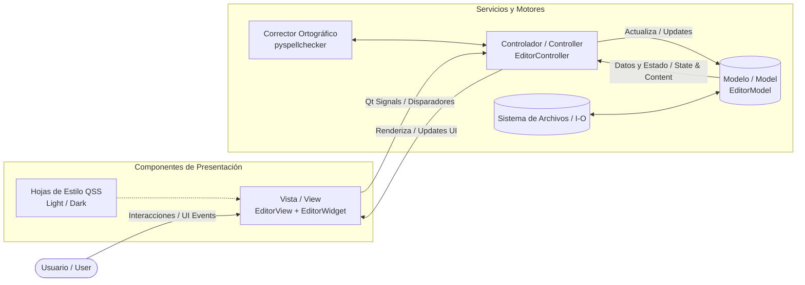

# NotepadX (Modern Notepad) 📝


[](https://www.python.org/)
[](https://riverbankcomputing.com/software/pyqt/)
[](#-architecture--arquitectura)
[](LICENSE)

> **English:** A sleek, modern Notepad desktop application built with Python and PyQt6 featuring tabs, dynamic light/dark themes, real-time Spanish spell checking, rich text styling, and an MVC architecture.
>
> **Español:** Un bloc de notas de escritorio moderno, limpio y minimalista desarrollado en Python y PyQt6 con pestañas, modo oscuro dinámico, corrector ortográfico en español, formato enriquecido y arquitectura MVC.

---

## 🌐 Language / Idioma
- [English Documentation](#-english-documentation)
- [Documentación en Español](#-documentación-en-español)
- [Architecture Diagram / Diagrama de Arquitectura](#-architecture--arquitectura)

---

## 🇬🇧 English Documentation

### Overview
**NotepadX** is a desktop text editor inspired by the Windows 11 Fluent Design language. It pairs a clean writing environment with productivity features such as rich text formatting, intelligent spell checking, customizable typography, and a dynamic theme engine.

### 🚀 Key Features
* 📑 **Multi-Tab Workspace:** Open, edit, and manage multiple documents concurrently with a quick `+` tab action.
* 🌓 **Dynamic Theme Engine:** Switch between polished Light and Dark modes in real-time via an integrated pill switch in the menu bar.
* ✨ **Rich Text Formatting:** Apply Bold (**B**), Italic (*I*), Strikethrough (~~S~~), and structured Headings (H1, H2, H3).
* ✍️ **Intelligent Spell Checker (Spanish):** Underlines misspelled terms in real time with contextual right-click replacement suggestions powered by `pyspellchecker`.
* 🔢 **Smart Line Numbers:** Integrated gutter with line counts and visual highlighting for the active editing line.
* 📊 **Live Status Bar:** Real-time statistics including total word count and accurate cursor coordinates (Line & Column).
* 🔍 **Find & Replace:** Fast, non-intrusive interactive search and replace panel.
* 📐 **Word Wrap Toggle:** Toggle dynamic line wrapping on demand from the View menu.
* 🏛️ **Decoupled MVC Pattern:** Strict separation of concerns between state/file logic, presentation, and user actions.

### 🛠️ Tech Stack
* **Language:** Python 3.10+
* **GUI Framework:** PyQt6
* **Spell Engine:** `pyspellchecker`
* **Styling:** Advanced Qt Style Sheets (QSS)

---

## 🇪🇸 Documentación en Español

### Descripción General
Una aplicación de bloc de notas moderna, limpia y minimalista desarrollada en Python utilizando el framework PyQt6. Este proyecto implementa el patrón de arquitectura **Modelo-Vista-Controlador (MVC)**, garantizando un código modular, escalable y fácil de mantener.

La interfaz está inspirada en las líneas de diseño del Bloc de Notas de Windows 11, añadiendo mejoras clave en la experiencia de usuario (modo oscuro dinámico, bordes redondeados, formato de texto) y herramientas para desarrolladores y redactores.

### 🚀 Características Principales
* **Pestañas Múltiples:** Soporte para trabajar con varios documentos simultáneamente con botón rápido `+`.
* **Modo Claro / Oscuro Dinámico:** Alternancia instantánea entre dos temas profesionales mediante un botón tipo píldora en la barra superior.
* **Editor de Texto Enriquecido:** Herramientas para Negrita (B), Cursiva (I), Tachado (S) y niveles de títulos (H1, H2, H3).
* **Corrector Ortográfico Inteligente (Español):** Subrayado en tiempo real y sugerencias en menú contextual.
* **Numeración de Líneas Avanzada:** Panel lateral integrado que resalta visualmente la línea activa del cursor.
* **Barra de Estado Inteligente:** Estadísticas en vivo de palabras totales y posición del cursor (Línea / Columna).
* **Buscar y Reemplazar:** Panel dinámico e integrado.
* **Ajuste de Línea (Word Wrap):** Alternable desde el menú Ver.
* **Arquitectura MVC:** Separación limpia de responsabilidades.

---

## 🏛️ Architecture / Arquitectura

El proyecto sigue una arquitectura desacoplada **Modelo-Vista-Controlador (MVC)** orientada a eventos Qt (Signals & Slots):



### Flujo de Datos / Data Flow
1. **User Action:** El usuario edita texto, abre un archivo o pulsa un atajo de teclado en la **Vista**.
2. **Signal Dispatch:** La **Vista** emite señales PyQt hacia el **Controlador**.
3. **Business Logic & Services:** El **Controlador** coordina con el motor ortográfico y solicita cambios de estado al **Modelo**.
4. **Model State & Persistence:** El **Modelo** gestiona el contenido de cada pestaña y la persistencia en disco.
5. **View Refresh:** El **Controlador** actualiza la interfaz, el conteo de palabras, la barra de estado y los estilos activos.

---

## 📂 Project Structure / Estructura del Proyecto

```text
NotepadX/
│
├── main.py                   # Entry point / Punto de entrada
├── requirements.txt          # Dependencies / Dependencias
├── README.md                 # Project documentation / Documentación
├── .gitignore                # Git exclusions / Reglas de exclusión Git
├── .env.example              # Environment template / Plantilla de entorno
│
└── app/
    ├── __init__.py
    ├── model.py              # File logic & tab data state / Lógica de datos
    ├── view.py               # UI components, menus & toolbars / Interfaz gráfica
    ├── controller.py         # Event orchestration & actions / Orquestador de eventos
    ├── editor_widget.py      # Custom editor with line numbers / Editor con gutter de líneas
    │
    ├── icons/                # Vector & UI icons / Iconos de la interfaz
    │
    └── styles/
        ├── light.qss         # Light theme stylesheet / Tema claro
        └── dark.qss          # Dark theme stylesheet / Tema oscuro
```

---

## ⚙️ Installation & Run / Instalación y Uso

1. **Clone the repository / Clonar el repositorio:**
   ```bash
   git clone https://github.com/tu-usuario/NotepadX.git
   cd NotepadX
   ```

2. **Create and activate a virtual environment / Crear entorno virtual:**
   ```bash
   # Windows (PowerShell)
   python -m venv .venv
   .venv\Scripts\Activate.ps1

   # Linux / macOS
   python3 -m venv .venv
   source .venv/bin/activate
   ```

3. **Install dependencies / Instalar dependencias:**
   ```bash
   pip install -r requirements.txt
   ```

4. **Launch NotepadX / Ejecutar la aplicación:**
   ```bash
   python main.py
   ```

---

## 🎨 UI/UX Design Decisions / Decisiones de Diseño

- **Fluent Spacing & Margins:** Espaciado y padding calibrados al píxel para brindar una experiencia compacta y moderna.
- **Pill-shaped Mode Switch:** Conmutador de modo claro/oscuro ubicado en la barra de menús para accesibilidad inmediata sin saturar la barra de herramientas.
- **Harmonized QTabBar:** Estilización personalizada en QSS para una integración limpia de pestañas activas e inactivas en ambos modos de color.
